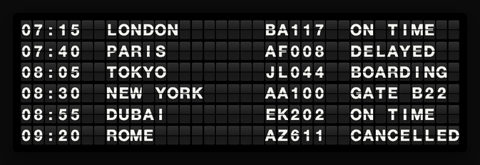
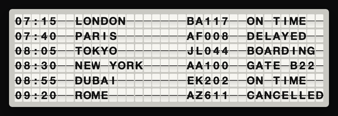
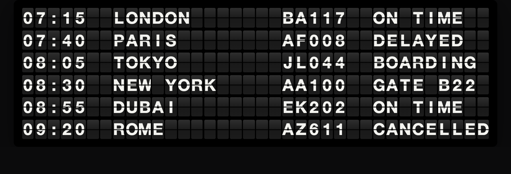
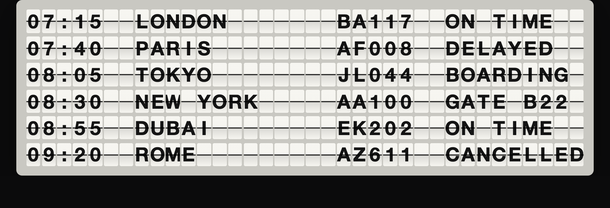
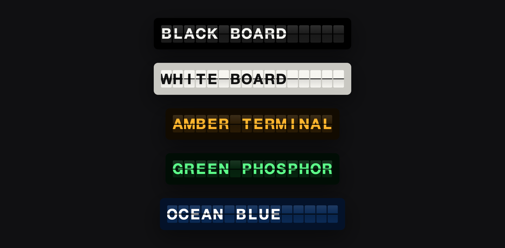
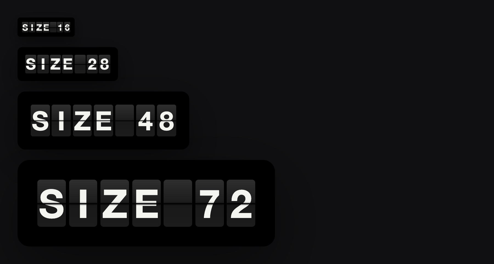
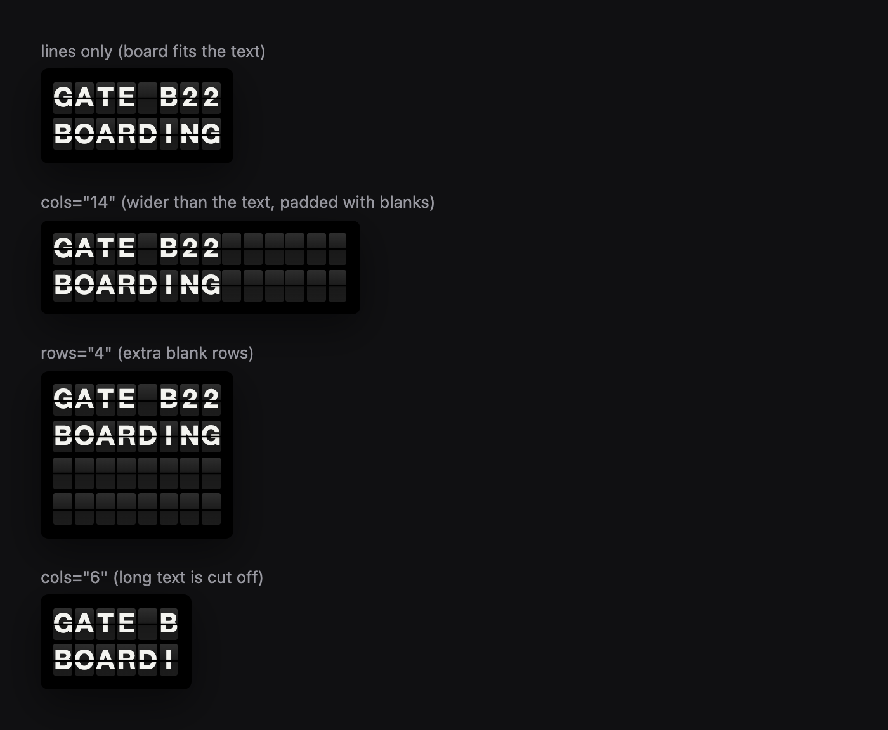

# split-flap

A modern [split-flap (Solari) display](https://en.wikipedia.org/wiki/Split-flap_display) in about 9 KB, with no dependencies. Use it as a `<split-flap>` web component, or as a plain JavaScript class when custom elements aren't available.

It runs in plain HTML, React, Next.js, Vue, Svelte, Angular, Chrome and Firefox extensions, and iOS or Android web views.





## Contents

[Quick start](#quick-start) · [Options](#options) · [Themes](#themes) · [Size](#size) · [Rows and columns](#rows-and-columns) · [Sound](#sound) · [Frameworks](#frameworks) · [Browser extensions](#browser-extensions) · [iOS and WebViews](#ios-and-webviews) · [API](#api) · [Develop](#develop)

## Quick start

### 1. Plain HTML (one tag, no build)

```html
<script type="module" src="https://cdn.jsdelivr.net/gh/flyptkarsh/split-flap/dist/split-flap.js"></script>

<split-flap
  cols="24"
  lines='["LONDON   BA117  ON TIME", "PARIS    AF008  DELAYED"]'
></split-flap>

<script>
  // Change the text any time. The flaps flip to the new message.
  document.querySelector("split-flap").lines = ["TOKYO    JL044  BOARDING"];
</script>
```

### 2. npm

```bash
npm i github:flyptkarsh/split-flap
```

```js
import "split-flap";                       // registers <split-flap>
import { createSplitFlap } from "split-flap";

const board = createSplitFlap(document.body, {
  lines: ["HELLO", "WORLD"],
  theme: "white",
  size: 40,
});
board.lines = ["GOODBYE", "WORLD"];
```

### 3. A single script tag (no ES modules, works from `file://` and in web views)

```html
<div id="mount"></div>
<script src="https://cdn.jsdelivr.net/gh/flyptkarsh/split-flap/dist/split-flap.global.js"></script>
<script>
  const board = SplitFlapLib.createSplitFlap(document.getElementById("mount"), {
    lines: ["HELLO FROM A WEBVIEW"], size: 28,
  });
</script>
```

## Options

Every option is an HTML attribute on `<split-flap>`, a property on the element, and a key in `createSplitFlap(container, options)`. All of them can be changed at any time.

| Option | Attribute | Property | Default | What it does |
| --- | --- | --- | --- | --- |
| Text | `lines='["A","B"]'` | `el.lines = ["A","B"]` | none | Rows of text. Letters are uppercased, and unknown characters become blanks. |
| Columns | `cols="24"` | `el.colCount = 24` | longest line | Characters per row. Shorter text is padded and longer text is cut off. |
| Rows | `rows="6"` | `el.rowCount = 6` | number of lines | Number of rows. Blank rows are added or extras are dropped. |
| Size | `size="40"` | `el.size = 40` | `2rem` | Board size: a number (px) or any CSS length such as `3rem`. |
| Theme | `theme="white"` | `el.theme = "white"` | `black` | `black` or `white` board. |
| Sound | `sound` | `el.sound = true` | off | Mechanical click on each flip. |
| Volume | `volume="0.3"` | `el.volume = 0.3` | `0.15` | Click volume from 0 to 1. |
| Speed | `flap-ms="50"` | `el.flapMs = 50` | `70` | Milliseconds per flip. Lower is faster. |
| Characters | `charset=" ABC123"` | not exposed | space, A–Z, 0–9, `: . - /` | The characters on the flap drum, in order. |

## Themes

Set `theme="black"` (the default) or `theme="white"`.





Make your own with CSS variables. The examples below are amber, green phosphor and ocean blue:

```css
split-flap.amber {
  --split-flap-bg:    #2a1b05;  /* flap color */
  --split-flap-fg:    #ffb62e;  /* letter color */
  --split-flap-frame: #120b01;  /* board background */
}
```



| CSS variable | Controls |
| --- | --- |
| `--split-flap-bg` | Flap color |
| `--split-flap-fg` | Letter color |
| `--split-flap-frame` | Board background |
| `--split-flap-gap` | Space between cells (default `.08em`) |
| `--split-flap-font` | Font family (default Helvetica Neue) |
| `--split-flap-font-size` | Size (same as the `size` option) |

## Size

`size` scales the whole board, so cells, gaps and the frame stay in proportion.

```html
<split-flap size="16" lines='["SIZE 16"]'></split-flap>
<split-flap size="3rem" lines='["SIZE 3REM"]'></split-flap>
```



For a responsive board, use a CSS length: `size="clamp(.8rem, 3vw, 2rem)"`.

## Rows and columns



- With neither option, the board fits your text.
- `cols` makes the board wider (blank padded flaps) or cuts long text off.
- `rows` adds blank rows, or drops extra lines.
- Setting `lines` on a board that already has text only flips the characters that changed.

## Sound

```html
<split-flap sound volume="0.2" lines='["CLICK CLACK"]'></split-flap>
```

```js
el.sound = false;   // mute
el.volume = 0.5;    // louder
```

The click is generated with the Web Audio API, so there are no audio files to load. Browsers (and iOS in particular) only allow sound after a user gesture. The library unlocks audio on the first tap, click or key press, so a board with `sound` set stays silent until then.

## Frameworks

### React / Next.js

```tsx
"use client";
import { useEffect, useRef } from "react";

export function Board({ lines }: { lines: string[] }) {
  const ref = useRef<HTMLElement & { lines: string[] }>(null);
  useEffect(() => { import("split-flap"); }, []);              // browser only
  useEffect(() => { if (ref.current) ref.current.lines = lines; }, [lines]);
  return <split-flap ref={ref} cols={24} theme="white" size={32} />;
}
```

For TypeScript, declare the tag once:

```ts
declare module "react" {
  namespace JSX { interface IntrinsicElements { "split-flap": any } }
}
```

### Vue 3

```vue
<script setup>
import "split-flap";
import { ref, watch } from "vue";
const el = ref(null);
const props = defineProps({ lines: Array });
watch(() => props.lines, (l) => { if (el.value) el.value.lines = l; }, { immediate: true, flush: "post" });
</script>
<template><split-flap ref="el" cols="24" theme="black" /></template>
```

Tell Vue it's a custom element: `compilerOptions.isCustomElement = (t) => t === "split-flap"`.

### Svelte

```svelte
<script>
  import "split-flap";
  export let lines = [];
  let el;
  $: if (el) el.lines = lines;
</script>
<split-flap bind:this={el} cols="24" theme="white" />
```

### Angular

Add `schemas: [CUSTOM_ELEMENTS_SCHEMA]` to the module, `import "split-flap"` in `main.ts`, then use `<split-flap #b cols="24"></split-flap>` and set `b.lines = [...]`.

## Browser extensions

Extension content scripts run in an isolated world where `customElements` is `null`, so `<split-flap>` can't register there. Use the plain-class API, which doesn't need it:

```js
// content.js — loaded after split-flap.global.js
const box = document.createElement("div");
box.style.cssText = "position:fixed;right:16px;bottom:16px;z-index:2147483647";
document.documentElement.append(box);

const board = SplitFlapLib.createSplitFlap(box, {
  lines: ["EXTENSION ACTIVE"], size: 18, theme: "black",
});
```


- Manifest V3 compatible: no inline scripts and no `eval`.
- Styles use `adoptedStyleSheets`, so a strict page Content-Security-Policy can't block them.
- The board lives in a shadow root, so page CSS can't leak in.
- Full working example: [`examples/chrome-extension`](examples/chrome-extension) (load it unpacked from `chrome://extensions`).
- In extension popup and options pages you can use `<split-flap>` normally.

## iOS and WebViews

Bundle `dist/split-flap.global.js` in your app and load it with a normal `<script>` (WKWebView blocks ES modules from `file://`). A ready-made SwiftUI wrapper is in [`examples/ios/SplitFlapView.swift`](examples/ios):

```swift
SplitFlapView(lines: ["GATE B22", "BOARDING"], theme: "white", size: 28)
    .frame(height: 140)
```

- Needs iOS 16.2 or newer (older versions render flat flaps; text still works).
- iOS plays sound only after a tap. Set `cfg.mediaTypesRequiringUserActionForPlayback = []` as in the example.
- Android WebView works the same way with the global build.

## API

```ts
class SplitFlap {
  constructor(host: HTMLElement, options?: SplitFlapOptions);
  set(options: SplitFlapOptions): this;       // change several options at once
  lines: string[];  cols: number;  rowCount: number;
  size: string | number | null;  theme: "black" | "white";
  sound: boolean;  volume: number;  flapMs: number;
  destroy(): void;                            // stop animating and remove the board
}

function createSplitFlap(container: HTMLElement, options?: SplitFlapOptions): SplitFlap;
```

`<split-flap>` is a thin wrapper over `SplitFlap`. The element has the same properties, plus `colCount` (instead of `cols`).

Behavior notes:
- Each flap cycles through the character set on its way to the target, like the real mechanism. A change from `A` to `Z` flips past every letter between them.
- One shared animation loop drives every flap, so hundreds of cells stay smooth. On a slow frame, flaps skip ahead instead of lagging.
- `prefers-reduced-motion` makes the board jump straight to the new text.
- The board has `role="img"` and an `aria-label` with the current text.

## Develop

```bash
npm install
npm run build      # writes dist/split-flap.js (ES module) and dist/split-flap.global.js (script tag)
python3 -m http.server 4173   # then open http://localhost:4173/examples/departures.html
```

Examples live in [`examples/`](examples): `departures.html`, `themes.html`, `sizes.html`, `layout.html`, `plain.html`, plus the extension and iOS projects.

## License

MIT
